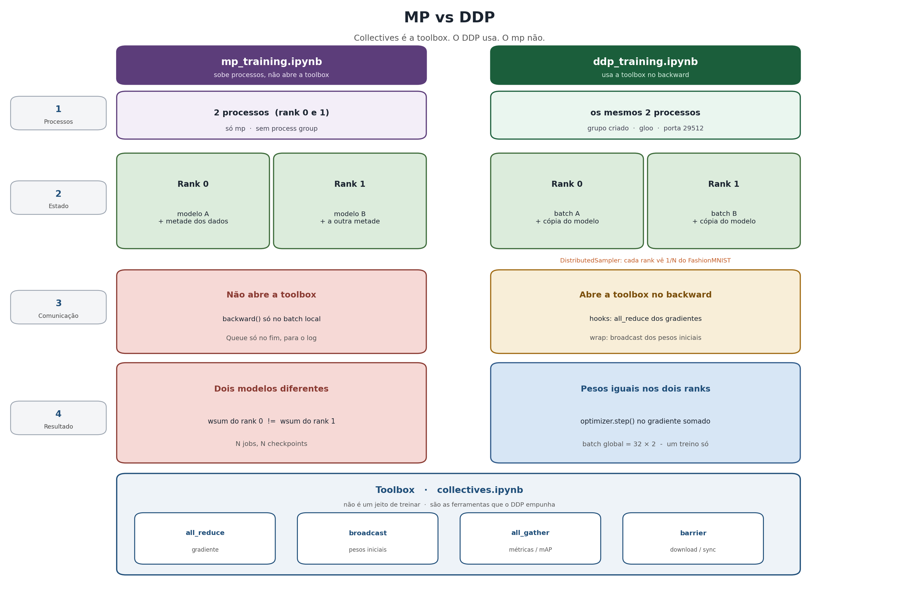

# MP vs DDP

Dois jeitos de treinar com vários processos. A diferença é uma só:
o DDP **usa** as primitivas de `torch.distributed`; o `mp` não.

| | `mp_training.ipynb` | `ddp_training.ipynb` |
|---|---|---|
| o que cada rank tem | cópia do modelo + metade dos dados | cópia do modelo + batch diferente |
| quem comunica | ninguém no treino (`Queue` só no fim, para o log) | o DDP, nos hooks do `backward()` |
| toolbox | não usa | usa `all_reduce`, `broadcast`, `barrier` |
| resultado | **dois** modelos | pesos iguais - **um** treino só |

`collectives.ipynb` não é um terceiro jeito de treinar. É a **toolbox**:
as ops (`all_reduce`, `broadcast`, `all_gather`, `barrier`) abertas na
mão, sem modelo. O DDP chama essas mesmas ops escondido no `backward()`.

Esta pasta é **data parallelism**. Pipeline e tensor entram quando o
modelo já não cabe numa GPU (não tem notebook aqui):

| | o que se fatia | cada GPU fica com | comunicação típica |
|---|---|---|---|
| **data (DDP)** | os **dados** | o modelo **inteiro** | `all_reduce` do gradiente |
| **pipeline** | as **camadas** (stage 1, stage 2, ...) | um pedaço vertical da rede | ativações entre stages |
| **tensor** | um **peso/ativação** dentro da camada | uma fatia da mesma `Linear`/`Attention` | `all_gather` / `all_reduce` no forward e no backward |

Pipeline: GPU 0 faz o bloco A, GPU 1 faz o bloco B, em microbatches.
Tensor: a mesma matriz `W` é partida no meio; as duas GPUs calculam a
mesma camada juntas. DDP não parte o modelo: parte o batch.

## Conceitos desta prática

| termo | o que é |
|---|---|
| **`torch.multiprocessing` (`mp`)** | sobe processos filhos. Cada um tem memória própria. Sozinho, não sincroniza treino |
| **`Queue`** | fila entre pai e filhos. Aqui só devolve o log no fim - não é `all_reduce` |
| **DDP** | wrapper no modelo. Você treina normal; ele pega as ferramentas da toolbox e sincroniza o gradiente |
| **data parallelism** | modelo inteiro em cada processo; o que se fatia são os **dados** (é o DDP) |
| **`DistributedSampler`** | cada rank vê `1/N` do dataset, sem repetir imagens |
| **batch local / global** | local = o de **um** rank (32). Global = `32 × N` (só existe de verdade com DDP) |
| **hook** | código que o autograd chama no `backward()`. No DDP: dispara o `all_reduce` |
| **rank** | o id do processo (`0` ou `1`). Rank 0 é o "chefe" |
| **world size (`N`)** | quantos processos existem (aqui, `N = 2`) |
| **process group** | o grupo dos ranks. Sem isso a toolbox não abre. O notebook de mp **não** tem |
| **backend** | quem troca os bytes: `gloo` (CPU, aula) ou `nccl` (GPU) |
| **MASTER_ADDR / PORT** | onde o rank 0 espera os outros (`127.0.0.1` + porta) |
| **`torchrun`** | sobe N cópias de um **script**. Não funciona no Jupyter |
| **`mp.start_processes`** | equivalente no notebook: 2 processos, `rank=0` e `rank=1` |

Toolbox (`collectives.ipynb`):

| ferramenta | o que faz | o DDP usa para |
|---|---|---|
| **`reduce`** | todos enviam; **só um rank** fica com o resultado | (raro no treino) |
| **`all_reduce`** | todos ficam com o resultado | somar os **gradientes** a cada step |
| **`broadcast`** | rank 0 copia o tensor para os outros | pesos iniciais iguais |
| **`scatter`** | rank 0 parte a lista; cada rank recebe um pedaço | fatiar batch / embeddings |
| **`gather`** | cada um manda o seu; **só o dst** recebe a lista | juntar métricas num rank |
| **`all_gather`** | cada um manda o seu; todos recebem a lista | métricas / mAP |
| **`barrier`** | todo mundo espera no mesmo ponto | download do dataset, fim de época |

## MP vs DDP



## Como rodar

Ordem sugerida: `mp_training` (o problema), `collectives` (a toolbox),
`ddp_training` (a solução). PyTorch (`gloo` já vem junto).
`mp_training` e DDP pedem `torchvision`.

Os workers escolhem o device sozinhos (CUDA se existir, senão CPU).
2 GPUs: DDP usa `nccl` e `cuda:rank`. 1 GPU e 2 processos: `gloo` na
mesma GPU. O `fork` do Jupyter não inicializa CUDA no processo pai.

## Dataset (FashionMNIST)

Não vai no git (`distributed/data/`, ~82 MB). Os notebooks baixam sozinhos
na primeira execução (`download=True`), para a pasta `data/` deste diretório.

Para baixar na mão, a partir de `exemplos-aula-03/distributed/`:

```python
import torchvision
torchvision.datasets.FashionMNIST(root="data", train=True, download=True)
```

Pode apagar `data/` depois da aula. O `coco8` da pasta `detection/` é o
microdataset da aula e **fica** no repositório.
